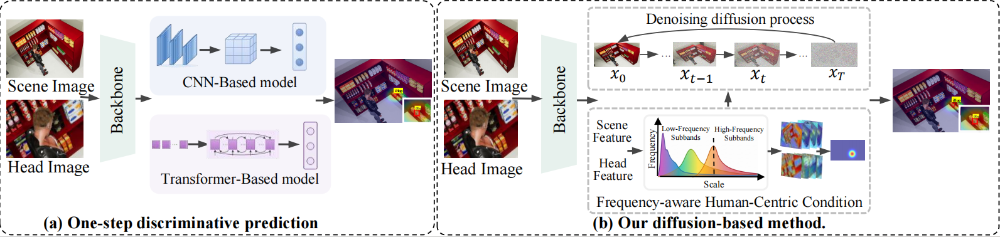
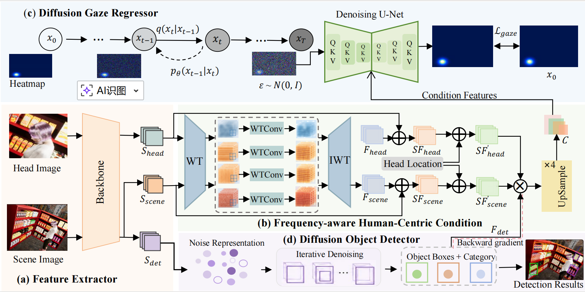
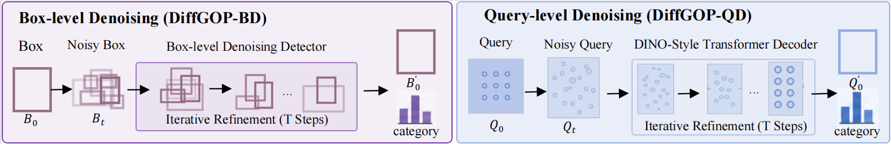

# DiffGOP: An End-to-End Diffusion Model for Gaze Object Prediction
Official repository for DiffGOP: An End-to-End Diffusion Model for Gaze Object Prediction, accepted by .

We provides the implementation of **DiffGOP**, an end-to-end diffusion framework for gaze object prediction. DiffGOP employs frequency-aware human-centric conditioning to capture human–target interactions and guide iterative denoising. It includes two approaches: **DiffGOP-BD**, which progressively refines gaze-target bounding boxes through box-level diffusion, and **DiffGOP-QD**, which refines gaze-target predictions through query-level diffusion. The repository provides:

   - Data of GOO_Synth, GOO_Real and DiSG.
   - code and pretrained model weights of DiffGOP-BD and DiffGOP-QD.
   



<p align="center">
  <em>Figure 1. Comparison between conventional one-step prediction and DiffGOP, which progressively refines gaze-target predictions through iterative diffusion denoising.</em>
</p>


# DiffGOP Framework


<p align="center">
  <em>Overall architecture of DiffGOP.</em>
</p>




<p align="center">
  <em>Box-level denoising in DiffGOP-BD and query-level denoising in DiffGOP-QD.</em>
</p>


## Dataset


## DiffGOP-BD Environment Setup

```bash
cd DiffGOP-BD
conda env create -f environment.yaml
conda activate DiffGOP-BD
```
The codebases are built on top of [Detectron2](https://github.com/facebookresearch/detectron2).

```bash
# under your working directory
cd detectron2
pip install -e .
python train_net.py --num-gpus 1 --config-file configs/diffdet.coco.res50.yaml
```


## DiffGOP-QD Environment Setup
```bash
cd DiffGOP-QD
conda env create -f environment.yaml
conda activate DiffGOP-QD
```
The codebases are built on top of [Detectron2](https://github.com/facebookresearch/detectron2).

```bash
# under your working directory
cd detectron2
pip install -e .
export DETECTRON2_DATASETS="/path/to/DiffuDETR/:$PYTHONPATH" 
export DETECTRON2_DATASETS=/path/to/datasets/
python /path/to/DiffuDETR-main/projects/diffu_dino/train_net.py --num-gpus 1 --config-file  /path/to/DiffuDETR-main/projects/diffu_dino/configs/dino-resnet/coco-r50-4scales-50ep.py
```


